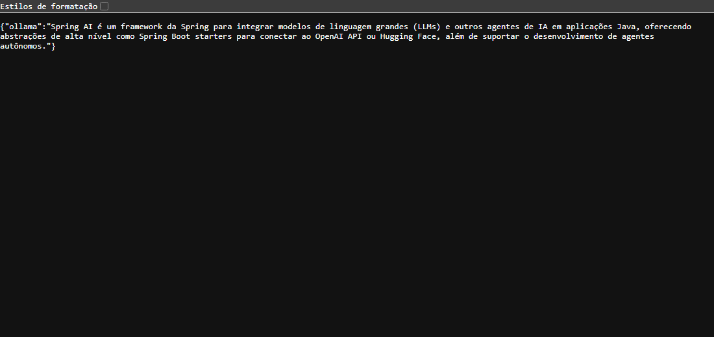
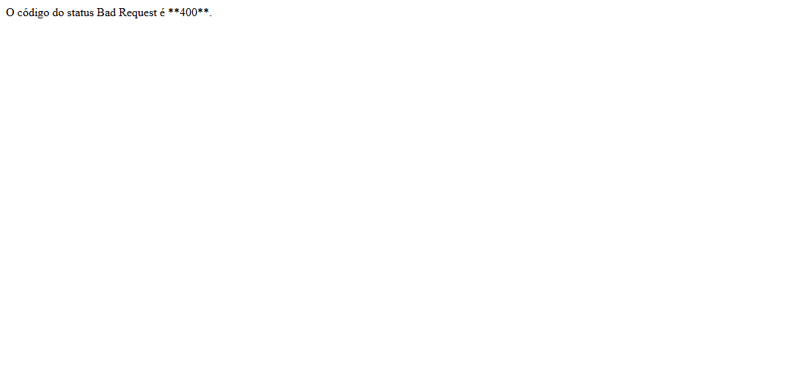
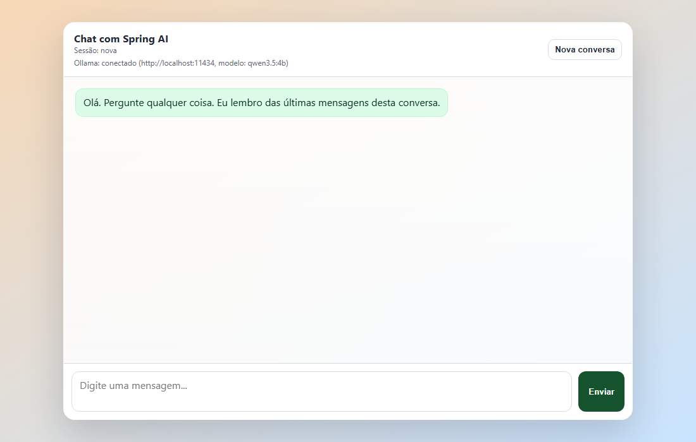

# AI Example - Spring AI, LangChain4j e Ollama

Projeto de exemplo para demonstrar o uso de IA generativa em Java com Spring Boot, Spring AI, LangChain4j e Ollama. A ideia é servir como material didático para comparar duas formas de conversar com um modelo local e também mostrar um exemplo simples de RAG usando um arquivo de texto.

## Tecnologias usadas

- Java 25
- Spring Boot 3.5.9
- Gradle
- Spring AI 1.1.4
- LangChain4j 1.12.2
- Ollama
- Modelo de chat: `qwen3.5:4b`
- Modelo de embeddings: `nomic-embed-text`
- Thymeleaf, para a página web de chat
- Springdoc OpenAPI, para documentação Swagger
- SimpleVectorStore do Spring AI, para o exemplo de RAG

## Como preparar o Ollama

Instale o Ollama e baixe os modelos usados no projeto:

```bash
ollama pull qwen3.5:4b
ollama pull nomic-embed-text
```

Depois deixe o Ollama rodando:

```bash
ollama serve
```

Em outro terminal, você também pode testar o modelo diretamente:

```bash
ollama run qwen3.5:4b
```

Por padrão, o Ollama fica disponível em:

```text
http://localhost:11434
```

## Como rodar o projeto

É necessário Java 25, conforme o `build.gradle`.

No Windows:

```bash
gradlew.bat bootRun
```

No Linux ou macOS:

```bash
./gradlew bootRun
```

Depois acesse:

```text
http://localhost:8080
```

## Página web

A aplicação possui uma página web em:

```text
GET /
```

Essa página abre um chat simples feito com Thymeleaf e JavaScript. Ela usa os endpoints do Spring AI:

- `POST /springai/chat`, para enviar mensagens.
- `POST /springai/chat/reset`, para limpar a conversa.
- `GET /springai/health`, para verificar se o Ollama está acessível.

O chat mantém um histórico curto em memória por `sessionId`, para simular memória de conversa.

## Endpoints disponíveis

### Spring AI

```text
GET /springai/generate?message=Sua pergunta
```

Envia uma pergunta simples para o modelo usando Spring AI.

Exemplo:

```bash
curl "http://localhost:8080/springai/generate?message=Explique%20Spring%20AI"
```

```text
POST /springai/chat
```

Envia uma mensagem para o chat com memória.

Corpo da requisição:

```json
{
  "sessionId": "",
  "message": "Explique o que e Spring AI"
}
```

Resposta:

```json
{
  "sessionId": "id-da-sessao",
  "response": "resposta do modelo"
}
```

```text
POST /springai/chat/reset
```

Remove o histórico de uma sessão.

Corpo da requisição:

```json
{
  "sessionId": "id-da-sessao"
}
```

```text
GET /springai/health
```

Verifica se o Ollama está respondendo e mostra o modelo configurado.

### LangChain4j

```text
GET /langchain4j/generate?message=Sua pergunta
```

Envia uma pergunta simples para o modelo usando LangChain4j.

Exemplo:

```bash
curl "http://localhost:8080/langchain4j/generate?message=Explique%20LangChain4j"
```

### RAG com Spring AI

```text
GET /rag/generate?message=Sua pergunta
```

Executa uma pergunta usando RAG. O projeto carrega o arquivo `src/main/resources/rfc7231.txt`, divide o texto em partes, grava ou reutiliza o `vectorstore.json` e busca trechos relacionados para montar o prompt.

Exemplo:

```bash
curl "http://localhost:8080/rag/generate?message=Qual%20o%20codigo%20do%20status%20Bad%20Request?"
```

## Testes da API

Os testes abaixo foram feitos com a aplicação rodando em `localhost:8080`, usando `qwen3.5:4b` como modelo de chat e `nomic-embed-text` como modelo de embeddings.

### 1. `GET /springai/generate`

Pergunta: "Explique em uma frase o que e Spring AI".



A resposta veio em português, em uma frase, em cerca de 11 segundos. Esse endpoint usa o `ChatClient` do Spring AI com o modelo configurado em `spring.ai.ollama.chat.model`.

### 2. `GET /langchain4j/generate`

Pergunta: "Explique em uma frase o que e LangChain4j".


A resposta também veio em português, em cerca de 13 segundos. Esse endpoint usa o `OllamaChatModel` do LangChain4j, configurado em `Lang4jChatService.java`. Os dois endpoints dão respostas parecidas porque usam o mesmo modelo, mas por bibliotecas diferentes.

### 3. `GET /rag/generate`

Pergunta: "Qual o codigo do status Bad Request?".



A resposta foi "400", que está correta segundo a RFC 7231 incluída no projeto. A primeira consulta demorou cerca de 6 minutos, porque o modelo roda no CPU. Esse endpoint busca trechos relevantes no `vectorstore.json` antes de chamar o modelo.

### Chatbot em localhost:8080



Página inicial do chat servida pela aplicação em `http://localhost:8080`.

## Swagger

A documentação dos endpoints fica disponível em:

```text
http://localhost:8080/swagger-ui/index.html
```

## Como mudar o modelo

### Modelo de chat e de embeddings

No arquivo `src/main/resources/application.properties`, altere:

```properties
spring.ai.ollama.chat.model=qwen3.5:4b
spring.ai.ollama.embedding.model=nomic-embed-text
```

Se trocar o modelo de embeddings, remova o arquivo `vectorstore.json` da raiz do projeto antes de usar o endpoint `/rag/generate`. Um arquivo gerado com outro modelo de embeddings causa erro 500 ou 501.

Se quiser usar outro modelo, primeiro baixe com o Ollama:

```bash
ollama pull nome-do-modelo:tag
```

Depois altere as propriedades para o mesmo nome.

### LangChain4j

No arquivo `src/main/java/com/luizreal/ai_example/langchain4j/Lang4jChatService.java`, altere o valor de `modelName`:

```java
return OllamaChatModel.builder()
        .baseUrl("http://localhost:11434")
        .modelName("qwen3.5:4b")
        .think(false)
        .build();
```

Se trocar para outro modelo, use o mesmo nome baixado pelo comando `ollama pull`.

### Raciocínio do modelo

O `qwen3.5` é um modelo com raciocínio. Com o raciocínio ligado, as respostas demoravam mais de 10 minutos no CPU desta máquina. Por isso o projeto desliga essa opção:

- Spring AI: `OllamaChatOptions.builder().disableThinking()` em `SpringAIChatService.java`.
- LangChain4j: `.think(false)` em `Lang4jChatService.java`.

Se o modelo trocado não tiver raciocínio, essas chamadas podem ser removidas.

## Observações para aula

- O endpoint `/springai/generate` mostra o uso direto do Spring AI.
- O endpoint `/langchain4j/generate` mostra o uso direto do LangChain4j.
- A página `/` usa Spring AI com memória simples em memória da aplicação.
- O endpoint `/rag/generate` demonstra uma consulta com RAG usando um documento local e um vector store simples.
- O projeto depende do Ollama em execução local para responder as chamadas de IA.
